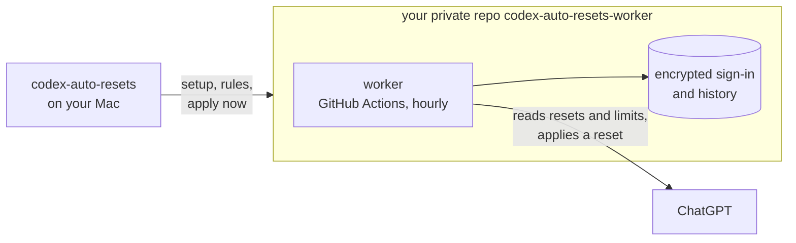

<div align="center">

```
 █████╗ ██████╗ ███████╗███████╗
██╔══██╗██╔══██╗██╔════╝██╔════╝
███████║██████╔╝█████╗  ███████╗
██╔══██║██╔══██╗██╔══╝  ╚════██║
██║  ██║██║  ██║███████╗███████║
╚═╝  ╚═╝╚═╝  ╚═╝╚══════╝╚══════╝
```

**Auto-RESets for Codex** — applies your issued ChatGPT rate-limit resets so they don't go to waste.<br>
Runs in your own private GitHub repo. Your Mac can be off.

[](docs/NOTICES.md)
[](docs/installation.en.md)
[](LICENSE)

**English** · [Русский](docs/README.ru.md)

</div>

## Features

- **No reset expires unused.** In the last 8 hours before a reset expires, the worker applies it.
- **Weekly limit hit — reset right away.** An optional rule applies the reset that expires first. Off by default.
- **Apply now.** Pick a reset in the terminal and the worker applies it, regardless of the rules.
- **No servers, no subscriptions.** Only GitHub Actions in your account: up to ~750 of the 2,000 free minutes a month.
- **Codex on your Mac is untouched.** The worker has its own ChatGPT sign-in; nothing is copied from your computer.

## Quick start

```sh
brew install keshaqaz/tap/codex-auto-resets
codex-auto-resets setup
```

`setup` signs you in to GitHub and ChatGPT with one-time codes, offers the rules and checks the worker.
The CLI speaks Russian:

```
Когда применять сбросы:
  1. Перед истечением (в последние 8 часов) — включено
  2. Когда кончится недельный лимит — выключено
Enter — готово, 1 или 2 — переключить:
Проверяем воркер…
Воркер работает. Сбросов: 2, ближайший истекает 22 октября 2026 г. в 15:00 UTC.
```

Full guide, including installing from source: [docs/installation.en.md](docs/installation.en.md).

## Commands

| Command | What it does |
| --- | --- |
| `codex-auto-resets setup` | install, or finish an interrupted install |
| `codex-auto-resets status` | resets, rules and worker health |
| `codex-auto-resets apply-now` | apply a chosen reset now |
| `codex-auto-resets rules` | choose when resets are applied |
| `codex-auto-resets login` | sign the worker in to ChatGPT again |
| `codex-auto-resets upgrade` | update the worker after `brew upgrade` |
| `codex-auto-resets uninstall` | remove the worker and the GitHub sign-in |

## How it works



GitHub Actions runs the worker about once an hour. Each run checks the resets against your rules and applies one when it's due. The Mac is only needed to install and control the worker.

## Limitations

- **Timing is approximate.** GitHub delays and skips scheduled runs, sometimes for hours. That's why the before-expiry rule works within an 8-hour window, not at an exact minute.
- **Paid ChatGPT plan required**, with 5-hour and weekly limits. On a plan with a single monthly limit the weekly rule never fires.
- **macOS only.** The CLI keeps its GitHub sign-in in the Keychain.
- **Broad GitHub access.** The GitHub sign-in gives the CLI access to all your repositories, like `gh`.
- **A real reset applied by the worker has not been verified live yet.** Reading resets and limits, sign-in and the apply request have been; details in [ADR-0004](docs/adr/0004-github-only-worker.md).

## Documentation

[Installation](docs/installation.en.md) ·
[Design: ADR-0004](docs/adr/0004-github-only-worker.md) ·
[Glossary (ru)](docs/CONTEXT.md) ·
[Releasing (ru)](docs/releasing.md)

## Development

```
src/
  cli/        codex-auto-resets commands
  worker/     the worker: run, rules, encrypted state, summary, workflow
  chatgpt/    ChatGPT device sign-in, resets and limits over HTTP
  github/     GitHub API and the OAuth App
scripts/      worker build and Homebrew release
test/         tests; support/ — fixtures
docs/         guides, glossary, adr/
```

`account/`, `session/`, `core/`, `schedule/`, `workflow/`, `installer/`, `src/cli.mjs` and the Cloudflare part of `src/worker/` are the previous architecture (ADR-0001–0003). The new CLI does not use them.

```sh
npm ci
npm test                          # offline, no network or credentials
npm run build:worker              # dist/worker.mjs, which setup and upgrade put into the repo
node src/cli/main.mjs status      # CLI from source
npm run release:brew              # Homebrew archive and formula, see docs/releasing.md
```

## License

[MIT](LICENSE) · third-party notices in [NOTICES.md](docs/NOTICES.md).
Unofficial project, not affiliated with OpenAI.
