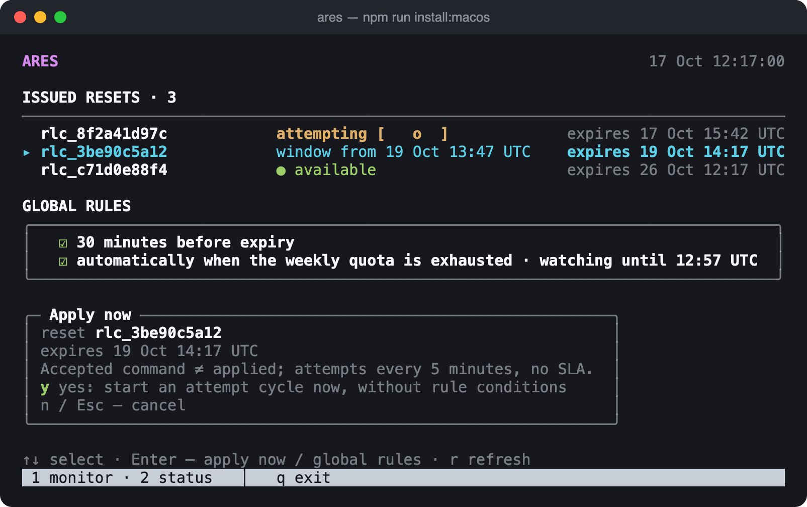
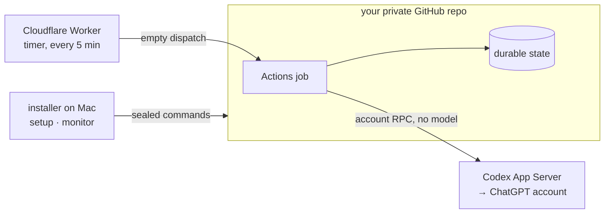
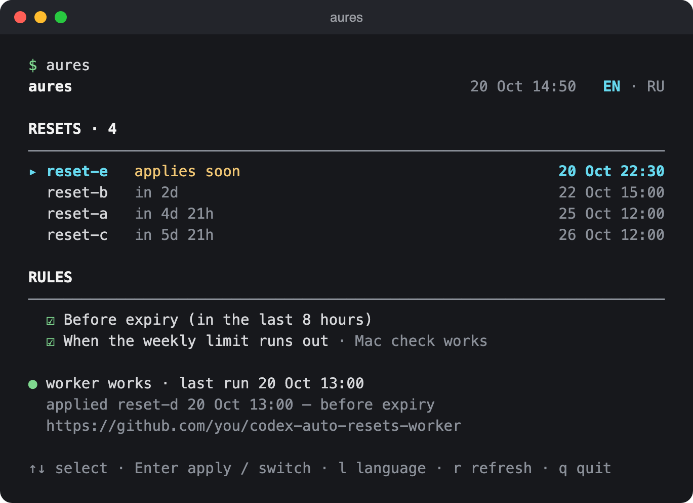

<div align="center">

```
 █████╗ ██████╗ ███████╗███████╗
██╔══██╗██╔══██╗██╔════╝██╔════╝
███████║██████╔╝█████╗  ███████╗
██╔══██║██╔══██╗██╔══╝  ╚════██║
██║  ██║██║  ██║███████╗███████║
╚═╝  ╚═╝╚═╝  ╚═╝╚══════╝╚══════╝
```

**Auto-RESets for Codex** — applies your issued rate-limit resets before they expire.<br>
Runs in your own private GitHub repo. Your Mac can be off.

[](NOTICES.md)
[](docs/installation.en.md)
[](docs/installation.en.md)
[](LICENSE)

**English** · [Русский](README.ru.md)



</div>

## Features

- **Never lose a reset** — apply it `Δ` minutes before expiry or 30 minutes before, for all resets.
- **Weekly auto-apply** — spend the nearest-expiring reset right after the weekly quota is confirmed exhausted.
- **Apply now** — one keypress in the monitor, with confirmation.
- **Serverless** — GitHub Actions does the work; a free Cloudflare Worker wakes it every 5 minutes.
- **Your credentials stay yours** — a separate CI login; desktop credentials are never copied.
- **$0 by design** — reads Actions usage before every job and stops behind a `$0 + Stop usage` budget.
- **Guided setup** — a ru/en terminal wizard, the token stored in the macOS Keychain.

## How it works



The target moment is `expiresAt − Δ`; attempts repeat every 5 minutes until success or expiry.
Details: [ADR-0002 external timer](docs/adr/0002-external-timer.md), [private workflow](docs/internals/private-workflow.md).

## Quick start

Requires macOS, Node **26.10.0**, official Codex **0.160.1** and a free Cloudflare account.

```sh
git clone https://github.com/Keshaqaz/ares.git && cd ares
npm ci --ignore-scripts --no-audit --no-fund
npm run install:macos
```

The wizard (`i`) walks through: private repo → installation token → install → ChatGPT login →
quota → external timer. Enabling (`6`) stays your explicit decision: set the repository variable
`AUTO_RESET_PILOT_APPROVED` to `owner/repo` first.
Full guide: [docs/installation.en.md](docs/installation.en.md).

## Monitor



| Key | Action |
| --- | --- |
| `↑` `↓` | select a reset or the rules block |
| `Enter` | apply now (confirm with `y`) / enter rules |
| `Space` | toggle a global rule |
| `2` | status and journal |
| `r` | refresh |
| `q` | back to the menu |

<sub>Screenshots use synthetic data.</sub>

## Limitations

- No SLA: neither Cloudflare nor GitHub promises punctual runs; a slot can be late or missed.
- Built for paid ChatGPT plans (5-hour and weekly windows).
- An accepted command is not an application; an unconfirmed outcome stops further attempts.

What was verified live and what was not: [support table](docs/support.md).

## Documentation

[Installation](docs/installation.en.md) ·
[Support](docs/support.md) ·
[Private workflow](docs/internals/private-workflow.md) ·
[Auth & storage](docs/internals/auth-storage.md) ·
[Reset cycles](docs/internals/reset-cycle-state.md) ·
[Planner & quota](docs/internals/schedule-planner.md) ·
[Glossary](CONTEXT.md)

## Development

```
src/
  account/    App Server RPC, account reads, observer
  session/    host-owned OAuth, CI session, revoke
  core/       reset-cycle engine, durable state, reports
  schedule/   planner, cron dialect, timer app
  github/     repo storage, billing, quota, timer plan
  workflow/   private Actions job entry point
  installer/  macOS installer, wizard, monitor
  cli.mjs     synthetic CLI
worker/       Cloudflare timer Worker
templates/    private workflow template
test/         tests; support/ — fixtures and contract runner
docs/         guides; internals/, adr/
```

```sh
npm test                      # offline, no credentials or network
npm run test:contract         # pinned App Server + synthetic backend
node src/cli.mjs --mode mock  # synthetic CLI
node scripts/release-package.mjs --verify
```

## License

[MIT](LICENSE) · third-party notices in [NOTICES.md](NOTICES.md).
Unofficial project, not affiliated with OpenAI.
