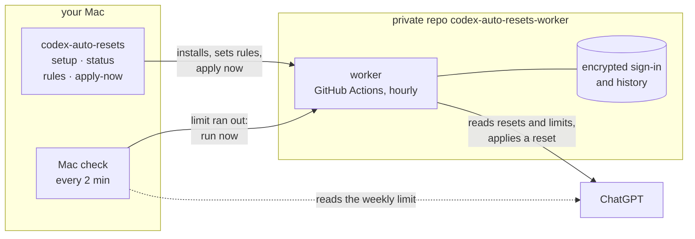

<div align="center">


### Auto-RESets for Codex

Applies your issued ChatGPT rate-limit resets so they don't go to waste.<br>
Runs in your own private GitHub repo. Your Mac can be off.

[](https://github.com/Keshaqaz/ares/releases/latest)
[](docs/installation.en.md)
[](docs/installation.en.md)
[](LICENSE)

**English** · [Русский](docs/README.ru.md)


</div>

## Features

- **No reset expires unused.** In the last 8 hours before a reset expires, the worker applies it.
- **Weekly limit hit — reset within minutes.** An optional rule applies the reset that expires first. While your Mac is awake, it checks the weekly limit every 2 minutes and calls the worker as soon as it runs out, whichever client used it up: Codex, opencode, your phone.
- **One screen.** `codex-auto-resets` shows the resets on top and the rules below. Enter on a reset applies it now, regardless of the rules; Enter on a rule switches it.
- **No servers, no subscriptions.** Only GitHub Actions in your account: up to ~750 of the 2,000 free minutes a month.
- **Codex on your Mac is untouched.** The worker and the Mac check have ChatGPT sign-ins of their own; nothing is copied from Codex.

## Quick start

```sh
brew install keshaqaz/tap/codex-auto-resets
codex-auto-resets setup
```

`setup` signs you in to GitHub and ChatGPT with one-time codes, creates the private repo `codex-auto-resets-worker`, offers the rules and runs the worker once:


The CLI speaks English; for Russian press `l` on the screen or run `codex-auto-resets language ru`.

Full guide, including installing from source: [docs/installation.en.md](docs/installation.en.md).

## Commands

| Command | What it does |
| --- | --- |
| *(no command)* | the screen: resets and rules; Enter applies a reset or switches a rule |
| `setup` | install, or finish an interrupted install |
| `status` | the same overview printed once: resets, rules, worker health and the Mac check |
| `apply-now` | apply a chosen reset now |
| `rules` | choose when resets are applied |
| `login` | sign the worker in to ChatGPT again |
| `upgrade` | update the worker after a new version |
| `uninstall` | remove the worker, the Mac check and the GitHub sign-in |
| `language en` / `language ru` | the language of the CLI; `l` on the screen does the same |

## How it works



**The worker** runs on GitHub Actions about once an hour, checks the resets against the rules and applies one when it's due. The Mac isn't needed for that: it only installs and controls the worker.

**The Mac check** is a launchd agent that runs while the weekly rule is on. It reads the weekly limit with the Mac's own ChatGPT sign-in and, once the limit runs out, starts the worker right away instead of waiting for the hourly run. The Mac never applies a reset itself: the worker reads the limit again and decides by the same rules. Design: [ADR-0005](docs/adr/0005-weekly-check-from-mac.md).

| Rule | Default | When a reset is applied |
| --- | --- | --- |
| Before expiry | on | less than 8 hours are left before it expires |
| When the weekly limit runs out | off | the weekly limit is used up; the reset that expires first goes |

Both rules cover all resets and work independently; change them with `codex-auto-resets rules`.

## Limitations

- **Timing is approximate.** GitHub delays and skips scheduled runs, sometimes for hours. That's why the before-expiry rule works within an 8-hour window, not at an exact minute.
- **The Mac check works only while the Mac is awake** and you are logged in to it. Otherwise the hourly run applies the reset, hours later.
- **One more ChatGPT code.** Turning the weekly rule on signs this Mac in to ChatGPT; the sign-in is kept in a file readable by your macOS user, and turning the rule off revokes it.
- **Paid ChatGPT plan required**, with 5-hour and weekly limits. On a plan with a single monthly limit the weekly rule never fires.
- **macOS only.** The CLI keeps its GitHub sign-in in the Keychain.
- **Broad GitHub access.** The GitHub sign-in gives the CLI access to all your repositories, like `gh`.
- **A real reset applied by the worker has not been verified live yet.** Reading resets and limits, sign-in and the apply request have been; details in [ADR-0004](docs/adr/0004-github-only-worker.md).

## Documentation

[Installation](docs/installation.en.md) ·
[Design: ADR-0004](docs/adr/0004-github-only-worker.md), [ADR-0005](docs/adr/0005-weekly-check-from-mac.md) ·
[Glossary (ru)](docs/CONTEXT.md) ·
[Releasing (ru)](docs/releasing.md)

## Development

```
src/
  cli/        codex-auto-resets commands; watch, mac-check, launch-agent — the Mac check
  worker/     the worker: run, rules, encrypted state, summary, workflow
  chatgpt/    ChatGPT device sign-in, resets and limits over HTTP
  github/     GitHub API and the OAuth App
scripts/      worker build and Homebrew release
test/         tests; support/ — fixtures
docs/         guides, glossary, adr/
```

```sh
npm ci
npm test                          # offline, no network or credentials
npm run build:worker              # dist/worker.mjs, which setup and upgrade put into the repo
node src/cli/main.mjs status      # CLI from source
node src/cli/main.mjs watch       # one pass of the Mac check, as the agent runs it
npm run release:brew              # Homebrew archive and formula, see docs/releasing.md
```

Screenshots show the real CLI output on the synthetic data from the tests.

## License

[MIT](LICENSE) · third-party notices in [NOTICES.md](docs/NOTICES.md).
Unofficial project, not affiliated with OpenAI.
