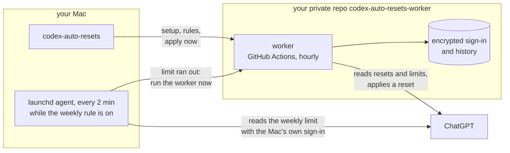

<div align="center">

```
 █████╗ ██████╗ ███████╗███████╗
██╔══██╗██╔══██╗██╔════╝██╔════╝
███████║██████╔╝█████╗  ███████╗
██╔══██║██╔══██╗██╔══╝  ╚════██║
██║  ██║██║  ██║███████╗███████║
╚═╝  ╚═╝╚═╝  ╚═╝╚══════╝╚══════╝
```

**Auto-RESets for Codex** — applies your issued ChatGPT rate-limit resets so they don't go to waste.<br>
Runs in your own private GitHub repo. Your Mac can be off.

[](docs/NOTICES.md)
[](docs/installation.en.md)
[](LICENSE)

**English** · [Русский](docs/README.ru.md)

</div>

## Features

- **No reset expires unused.** In the last 8 hours before a reset expires, the worker applies it.
- **Weekly limit hit — reset within minutes.** An optional rule applies the reset that expires first. While the rule is on and your Mac is awake, the Mac checks the weekly limit every 2 minutes and calls the worker as soon as it runs out, whichever client used it up: Codex, opencode, your phone. Off by default.
- **Apply now.** Pick a reset in the terminal and the worker applies it, regardless of the rules.
- **No servers, no subscriptions.** Only GitHub Actions in your account: up to ~750 of the 2,000 free minutes a month.
- **Codex on your Mac is untouched.** The worker and the Mac check have ChatGPT sign-ins of their own; nothing is copied from Codex.

## Quick start

```sh
brew install keshaqaz/tap/codex-auto-resets
codex-auto-resets setup
```

`setup` signs you in to GitHub and ChatGPT with one-time codes, offers the rules and checks the worker.
The CLI speaks Russian:

```
Когда применять сбросы:
  1. Перед истечением (в последние 8 часов) — включено
  2. Когда кончится недельный лимит — выключено
Enter — готово, 1 или 2 — переключить:
Проверяем воркер…
Воркер работает. Сбросов: 2, ближайший истекает 22 октября 2026 г. в 15:00 UTC.
```

With the weekly rule on, `setup` asks for one more ChatGPT code, for the Mac check.

Full guide, including installing from source: [docs/installation.en.md](docs/installation.en.md).

## Commands

| Command | What it does |
| --- | --- |
| `codex-auto-resets setup` | install, or finish an interrupted install |
| `codex-auto-resets status` | resets, rules, worker health and the Mac check |
| `codex-auto-resets apply-now` | apply a chosen reset now |
| `codex-auto-resets rules` | choose when resets are applied; turns the Mac check on or off with the weekly rule |
| `codex-auto-resets login` | sign the worker in to ChatGPT again |
| `codex-auto-resets upgrade` | update the worker after `brew upgrade` |
| `codex-auto-resets uninstall` | remove the worker, the Mac check and the GitHub sign-in |

## How it works



GitHub Actions runs the worker about once an hour. Each run checks the resets against your rules and applies one when it's due. For that the Mac is not needed: it only installs and controls the worker.

With the weekly rule on, a launchd agent on the Mac runs `codex-auto-resets watch` every 2 minutes. It reads the weekly limit with a separate ChatGPT sign-in of the Mac, and once the limit runs out, starts one worker run per weekly window, as the schedule would. The Mac never applies a reset: the worker reads the limit itself and decides by the same rules. If the Mac is asleep or off, the hourly run notices the limit. Design: [ADR-0005](docs/adr/0005-weekly-check-from-mac.md).

## Limitations

- **Timing is approximate.** GitHub delays and skips scheduled runs, sometimes for hours. That's why the before-expiry rule works within an 8-hour window, not at an exact minute.
- **The Mac check works only while the Mac is awake** and you are logged in to it. It polls every 2 minutes, so the reset comes a few minutes after the weekly limit runs out; otherwise the hourly run applies it, hours later.
- **One more ChatGPT code.** Turning the weekly rule on signs this Mac in to ChatGPT; the sign-in is kept in a file readable by your macOS user, and turning the rule off revokes it.
- **Paid ChatGPT plan required**, with 5-hour and weekly limits. On a plan with a single monthly limit the weekly rule never fires.
- **macOS only.** The CLI keeps its GitHub sign-in in the Keychain.
- **Broad GitHub access.** The GitHub sign-in gives the CLI access to all your repositories, like `gh`.
- **A real reset applied by the worker has not been verified live yet.** Reading resets and limits, sign-in and the apply request have been; details in [ADR-0004](docs/adr/0004-github-only-worker.md).

## Documentation

[Installation](docs/installation.en.md) ·
[Design: ADR-0004](docs/adr/0004-github-only-worker.md), [ADR-0005](docs/adr/0005-weekly-check-from-mac.md) ·
[Glossary (ru)](docs/CONTEXT.md) ·
[Releasing (ru)](docs/releasing.md)

## Development

```
src/
  cli/        codex-auto-resets commands; watch, mac-check, launch-agent — the Mac check
  worker/     the worker: run, rules, encrypted state, summary, workflow
  chatgpt/    ChatGPT device sign-in, resets and limits over HTTP
  github/     GitHub API and the OAuth App
scripts/      worker build and Homebrew release
test/         tests; support/ — fixtures
docs/         guides, glossary, adr/
```

```sh
npm ci
npm test                          # offline, no network or credentials
npm run build:worker              # dist/worker.mjs, which setup and upgrade put into the repo
node src/cli/main.mjs status      # CLI from source
node src/cli/main.mjs watch       # one pass of the Mac check, as the agent runs it
npm run release:brew              # Homebrew archive and formula, see docs/releasing.md
```

## License

[MIT](LICENSE) · third-party notices in [NOTICES.md](docs/NOTICES.md).
Unofficial project, not affiliated with OpenAI.
