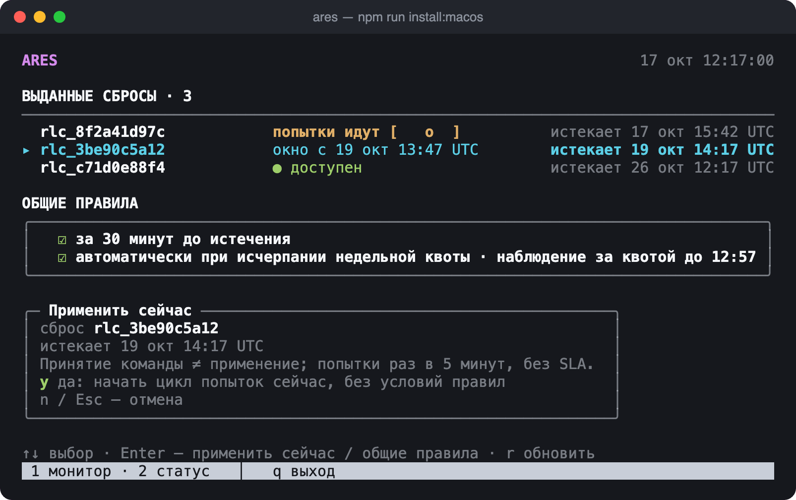
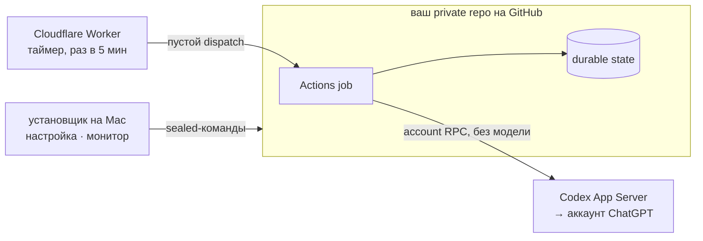

<div align="center">

```
 █████╗ ██████╗ ███████╗███████╗
██╔══██╗██╔══██╗██╔════╝██╔════╝
███████║██████╔╝█████╗  ███████╗
██╔══██║██╔══██╗██╔══╝  ╚════██║
██║  ██║██║  ██║███████╗███████║
╚═╝  ╚═╝╚═╝  ╚═╝╚══════╝╚══════╝
```

**Auto-RESets for Codex** — применяет выданные сбросы лимитов до истечения их срока.<br>
Работает в вашем private repo на GitHub. Компьютер может быть выключен.

[](NOTICES.md)
[](docs/installation.md)
[](docs/installation.md)
[](LICENSE)

[English](README.md) · **Русский**



</div>

## Возможности

- **Сброс не сгорит** — применяется за `Δ` минут до истечения или по общему правилу «за 30 минут».
- **Недельное автоприменение** — сброс с ближайшим сроком тратится сразу после подтверждённого исчерпания недельной квоты.
- **Применить сейчас** — одна клавиша в мониторе, с подтверждением.
- **Без сервера** — работу выполняет GitHub Actions, бесплатный Cloudflare Worker будит его раз в 5 минут.
- **Свои credentials** — отдельный CI-вход; данные desktop-клиента не копируются.
- **$0 по устройству** — расход Actions читается перед каждой job, ограничитель — бюджет `$0 + Stop usage`.
- **Мастер настройки** — терминальный интерфейс ru/en, токен хранится в macOS Keychain.

## Как это работает



Целевой момент — `expiresAt − Δ`; попытки повторяются раз в 5 минут до успеха или истечения.
Подробнее: [ADR-0002 внешний таймер](docs/adr/0002-external-timer.md), [private workflow](docs/internals/private-workflow.md).

## Быстрый старт

Нужны macOS, Node **26.10.0**, официальный Codex **0.160.1** и бесплатный аккаунт Cloudflare.

```sh
git clone https://github.com/Keshaqaz/ares.git && cd ares
npm ci --ignore-scripts --no-audit --no-fund
npm run install:macos
```

Мастер (`i`) проводит по шагам: private repo → токен установки → установка → вход ChatGPT →
квота → внешний таймер. Включение (`6`) — отдельное решение владельца: сначала задайте
repository variable `AUTO_RESET_PILOT_APPROVED` = `owner/repo`.
Полная инструкция: [docs/installation.md](docs/installation.md).

## Монитор


| Клавиша | Действие |
| --- | --- |
| `↑` `↓` | выбор сброса или блока правил |
| `Enter` | применить сейчас (подтверждение `y`) / войти в правила |
| `Space` | переключить общее правило |
| `2` | статус и журнал |
| `r` | обновить |
| `q` | назад в меню |

<sub>На скриншотах синтетические данные.</sub>

## Ограничения

- Без SLA: ни Cloudflare, ни GitHub не обещают пунктуальность — слот может задержаться или пропасть.
- Рассчитано на платные планы ChatGPT (пятичасовое и недельное окна).
- Принятая команда ≠ применение; неподтверждённый исход останавливает новые попытки.

Что проверено вживую, а что нет — [таблица поддержки](docs/support.md).

## Документация

[Установка](docs/installation.md) ·
[Поддержка](docs/support.md) ·
[Private workflow](docs/internals/private-workflow.md) ·
[Auth и storage](docs/internals/auth-storage.md) ·
[Циклы сбросов](docs/internals/reset-cycle-state.md) ·
[Планировщик и квота](docs/internals/schedule-planner.md) ·
[Словарь](CONTEXT.md)

## Разработка

```
src/
  account/    App Server RPC, чтение аккаунта, observer
  session/    host-owned OAuth, CI-сессия, revoke
  core/       движок циклов, durable state, отчёты
  schedule/   планировщик, cron-диалект, приложение таймера
  github/     storage в repo, billing, квота, план таймера
  workflow/   точка входа private Actions job
  installer/  установщик macOS, мастер, монитор
  cli.mjs     synthetic CLI
worker/       Worker внешнего таймера Cloudflare
templates/    шаблон private workflow
test/         тесты; support/ — фикстуры и contract runner
docs/         руководства; internals/, adr/
```

```sh
npm test                      # offline, без credentials и сети
npm run test:contract         # pinned App Server + synthetic backend
node src/cli.mjs --mode mock  # synthetic CLI
node scripts/release-package.mjs --verify
```

## Лицензия

[MIT](LICENSE) · сторонние компоненты — [NOTICES.md](NOTICES.md).
Неофициальный проект, не связан с OpenAI.
