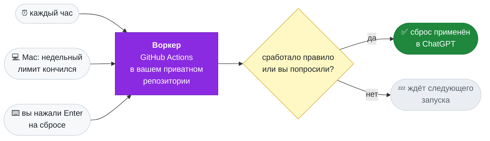

<div align="center">


### AUto-RESets for Codex

Сам применяет выданные сбросы лимита ChatGPT, чтобы они не сгорали.<br>
Работает в вашем приватном репозитории на GitHub. Компьютер можно выключить.

[](https://github.com/Keshaqaz/aures/releases/latest)
[](installation.md)
[](installation.md)
[](../LICENSE)

[English](../README.md) · **Русский**


</div>

## Что умеет

- **Сброс не сгорит.** В последние 8 часов перед истечением воркер применяет сброс сам.
- **Кончился недельный лимит — сброс через минуты.** Правило можно включить: воркер применит сброс с ближайшим сроком. Пока Mac не спит, он раз в 2 минуты проверяет недельный лимит и зовёт воркер, как только лимит кончится, в каком бы клиенте его ни израсходовали: Codex, opencode, телефон.
- **Один экран.** `aures` показывает сбросы сверху и правила снизу. Enter на сбросе применяет его сейчас, без всяких правил; Enter на правиле переключает его.
- **Без серверов и подписок.** Работает только GitHub Actions в вашем аккаунте: до ~750 минут в месяц из 2000 бесплатных.
- **Codex на Mac не затронут.** У воркера и у проверки с Mac свои входы в ChatGPT, данные Codex не копируются.

> [!IMPORTANT]
> ### 🔒 Ваши токены никуда не уходят
>
> У AURES нет своего сервера, он ничего не собирает. Всё работает на **вашем** Mac и в **вашем** аккаунте GitHub:
>
> - **Вход в GitHub** хранится в связке ключей (Keychain) вашего Mac.
> - **Вход воркера в ChatGPT** лежит в вашем приватном репозитории, зашифрованный AES-256-GCM. Ключ — секрет Actions, который может прочитать только ваш собственный workflow.
> - **Вход проверки с Mac в ChatGPT** хранится в файле на вашем Mac.
> - CLI и воркер обращаются только к GitHub и OpenAI. Никакой телеметрии, никаких третьих сторон, даже автор проекта ничего не получает.
>
> Код открыт: проверьте сами в [src/](../src/).

## Быстрый старт

```sh
brew install keshaqaz/tap/aures
aures language ru
aures setup
```

По умолчанию CLI говорит по-английски; `language ru` переключает его на русский. На экране язык переключает клавиша `l`.

`setup` попросит войти в GitHub и в ChatGPT по коду, создаст приватный репозиторий `codex-auto-resets-worker`, предложит правила и один раз запустит воркер:


Подробно, в том числе об установке из исходников, — в [инструкции](installation.md).

## Команды

| Команда | Что делает |
| --- | --- |
| `setup` | установить или продолжить прерванную установку |
| *(без команды)* | экран: сбросы и правила; Enter применяет сброс или переключает правило |
| `status` | то же одним выводом: сбросы, правила, состояние воркера и проверки с Mac |
| `apply-now` | применить выбранный сброс сейчас |
| `rules` | выбрать, когда применять сбросы |
| `login` | заново войти в ChatGPT, если воркер потерял вход |
| `upgrade` | обновить воркер после выхода новой версии |
| `uninstall` | удалить воркер, проверку с Mac и вход в GitHub |
| `language en` / `language ru` | язык программы; на экране то же делает клавиша `l` |

## Как это работает



**Воркер** запускается по расписанию GitHub Actions примерно раз в час, сверяет сбросы с правилами и применяет нужный. Компьютер для этого не нужен: Mac участвует только в установке и управлении.

**Проверка с Mac** — агент launchd, который работает, пока включено недельное правило. Он читает недельный лимит отдельным входом Mac в ChatGPT и, как только лимит кончился, сразу запускает воркер, не дожидаясь планового запуска. Сам Mac сброс не применяет: воркер ещё раз читает лимит и решает по тем же правилам. Устройство — в [ADR-0005](adr/0005-weekly-check-from-mac.md).

| Правило | По умолчанию | Когда применяется сброс |
| --- | --- | --- |
| Перед истечением | включено | до истечения сброса осталось меньше 8 часов |
| Когда кончится недельный лимит | выключено | недельный лимит израсходован; уходит сброс с ближайшим сроком |

Правила действуют на все сбросы сразу и независимо друг от друга; меняются командой `aures rules`.

## Ограничения

- **Время не точное.** GitHub запускает расписание с задержками и пропусками, иногда по нескольку часов. Поэтому правило «перед истечением» срабатывает в окне 8 часов, а не в конкретную минуту.
- **Проверка с Mac работает, только пока Mac не спит** и вы вошли в свою учётную запись macOS. Иначе сброс применит плановый запуск, на часы позже.
- **Ещё один код ChatGPT.** При включении недельного правила нужно ещё раз войти в ChatGPT, уже для этого Mac. Вход хранится в файле, доступном вашему пользователю macOS. Выключение правила его не трогает, отзывает его `aures uninstall`.
- **Нужен платный план ChatGPT** с пятичасовым и недельным лимитами. Если у плана один месячный лимит, правило «когда кончится недельный лимит» не срабатывает.
- **Только macOS.** CLI хранит вход в GitHub в Связке ключей.
- **Широкий доступ к GitHub.** Вход в GitHub даёт CLI доступ ко всем вашим репозиториям, как у `gh`.
- **Применение настоящего сброса воркером вживую пока не проверено.** Чтение сбросов и лимитов, вход и запрос применения проверены, подробности — в [ADR-0004](adr/0004-github-only-worker.md).

## Документация

[Установка](installation.md) ·
[Устройство: ADR-0004](adr/0004-github-only-worker.md), [ADR-0005](adr/0005-weekly-check-from-mac.md) ·
[Словарь](CONTEXT.md) ·
[Выпуск версии](releasing.md)

## Разработка

```
src/
  cli/        команды aures; watch, mac-check, launch-agent — проверка с Mac
  worker/     воркер: запуск, правила, шифрованный state, сводка, workflow
  chatgpt/    вход в ChatGPT по коду, сбросы и лимиты по HTTP
  github/     GitHub API и OAuth App
scripts/      сборка воркера и выпуск для Homebrew
test/         тесты; support/ — фикстуры
docs/         инструкции, словарь, adr/
```

```sh
npm ci
npm test                          # офлайн, без сети и учётных данных
npm run typecheck                 # проверка типов tsc без сборки; Node запускает .ts напрямую
npm run build:worker              # dist/worker.mjs, его кладут в репозиторий setup и upgrade
node src/cli/main.ts status       # CLI из исходников
node src/cli/main.ts watch        # один проход проверки с Mac, как его запускает агент
npm run release:brew              # архив и формула Homebrew, см. docs/releasing.md
```

На скриншотах — настоящий вывод CLI на синтетических данных из тестов.

## Лицензия

[MIT](../LICENSE) · сторонние компоненты — [NOTICES.md](NOTICES.md).
Неофициальный проект, не связан с OpenAI.
