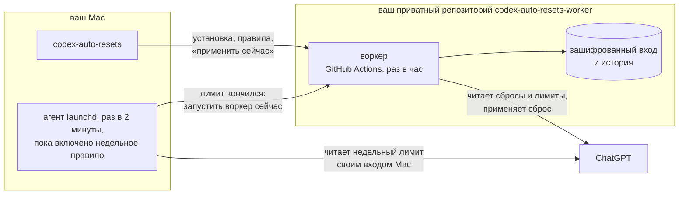

<div align="center">

```
 █████╗ ██████╗ ███████╗███████╗
██╔══██╗██╔══██╗██╔════╝██╔════╝
███████║██████╔╝█████╗  ███████╗
██╔══██║██╔══██╗██╔══╝  ╚════██║
██║  ██║██║  ██║███████╗███████║
╚═╝  ╚═╝╚═╝  ╚═╝╚══════╝╚══════╝
```

**Auto-RESets for Codex** — сам применяет выданные сбросы лимита ChatGPT, чтобы они не сгорали.<br>
Работает в вашем приватном репозитории на GitHub. Компьютер можно выключить.

[](NOTICES.md)
[](installation.md)
[](../LICENSE)

[English](../README.md) · **Русский**

</div>

## Что умеет

- **Сброс не сгорит.** В последние 8 часов перед истечением воркер применяет сброс сам.
- **Кончился недельный лимит — сброс через минуты.** Правило можно включить: воркер применит сброс с ближайшим сроком. Пока правило включено и Mac не спит, Mac раз в 2 минуты проверяет недельный лимит и зовёт воркер, как только лимит кончится, в каком бы клиенте его ни израсходовали: Codex, opencode, телефон. По умолчанию выключено.
- **Применить сейчас.** Выбираете сброс в терминале, и воркер применяет его без всяких правил.
- **Без серверов и подписок.** Работает только GitHub Actions в вашем аккаунте: до ~750 минут в месяц из 2000 бесплатных.
- **Codex на Mac не затронут.** У воркера и у проверки с Mac свои входы в ChatGPT, данные Codex не копируются.

## Быстрый старт

```sh
brew install keshaqaz/tap/codex-auto-resets
codex-auto-resets setup
```

`setup` попросит войти в GitHub и в ChatGPT по коду, предложит правила и проверит воркер:

```
Когда применять сбросы:
  1. Перед истечением (в последние 8 часов) — включено
  2. Когда кончится недельный лимит — выключено
Enter — готово, 1 или 2 — переключить:
Проверяем воркер…
Воркер работает. Сбросов: 2, ближайший истекает 22 октября 2026 г. в 15:00 UTC.
```

Если включить правило «когда кончится недельный лимит», `setup` попросит ещё один код ChatGPT, для проверки с Mac.

Подробно, в том числе об установке из исходников, — в [инструкции](installation.md).

## Команды

| Команда | Что делает |
| --- | --- |
| `codex-auto-resets setup` | установить или продолжить прерванную установку |
| `codex-auto-resets status` | сбросы, правила, состояние воркера и проверки с Mac |
| `codex-auto-resets apply-now` | применить выбранный сброс сейчас |
| `codex-auto-resets rules` | выбрать, когда применять сбросы; вместе с недельным правилом включает или выключает проверку с Mac |
| `codex-auto-resets login` | заново войти в ChatGPT, если воркер потерял вход |
| `codex-auto-resets upgrade` | обновить воркер после `brew upgrade` |
| `codex-auto-resets uninstall` | удалить воркер, проверку с Mac и вход в GitHub |

## Как это работает



Воркер запускается по расписанию GitHub Actions примерно раз в час, сверяет сбросы с правилами и применяет нужный. Компьютер для этого не нужен: Mac участвует только в установке и управлении.

Когда недельное правило включено, агент launchd на Mac раз в 2 минуты запускает `codex-auto-resets watch`. Он читает недельный лимит отдельным входом Mac в ChatGPT и, как только лимит кончился, один раз на это недельное окно запускает воркер, как это сделало бы расписание. Сам Mac сброс не применяет: воркер читает лимит своим входом и решает по тем же правилам. Если Mac спит или выключен, лимит заметит плановый запуск. Устройство — в [ADR-0005](adr/0005-weekly-check-from-mac.md).

## Ограничения

- **Время не точное.** GitHub запускает расписание с задержками и пропусками, иногда по нескольку часов. Поэтому правило «перед истечением» срабатывает в окне 8 часов, а не в конкретную минуту.
- **Проверка с Mac работает, только пока Mac не спит** и вы вошли в свою учётную запись macOS. Она опрашивает лимит раз в 2 минуты, поэтому сброс приходит через несколько минут после того, как кончился недельный лимит. Иначе его применит плановый запуск, на часы позже.
- **Ещё один код ChatGPT.** При включении недельного правила нужно ещё раз войти в ChatGPT, уже для этого Mac. Вход хранится в файле, доступном вашему пользователю macOS; выключение правила его отзывает.
- **Нужен платный план ChatGPT** с пятичасовым и недельным лимитами. Если у плана один месячный лимит, правило «когда кончится недельный лимит» не срабатывает.
- **Только macOS.** CLI хранит вход в GitHub в Связке ключей.
- **Широкий доступ к GitHub.** Вход в GitHub даёт CLI доступ ко всем вашим репозиториям, как у `gh`.
- **Применение настоящего сброса воркером вживую пока не проверено.** Чтение сбросов и лимитов, вход и запрос применения проверены, подробности — в [ADR-0004](adr/0004-github-only-worker.md).

## Документация

[Установка](installation.md) ·
[Устройство: ADR-0004](adr/0004-github-only-worker.md), [ADR-0005](adr/0005-weekly-check-from-mac.md) ·
[Словарь](CONTEXT.md) ·
[Выпуск версии](releasing.md)

## Разработка

```
src/
  cli/        команды codex-auto-resets; watch, mac-check, launch-agent — проверка с Mac
  worker/     воркер: запуск, правила, шифрованный state, сводка, workflow
  chatgpt/    вход в ChatGPT по коду, сбросы и лимиты по HTTP
  github/     GitHub API и OAuth App
scripts/      сборка воркера и выпуск для Homebrew
test/         тесты; support/ — фикстуры
docs/         инструкции, словарь, adr/
```

```sh
npm ci
npm test                          # офлайн, без сети и учётных данных
npm run build:worker              # dist/worker.mjs, его кладут в репозиторий setup и upgrade
node src/cli/main.mjs status      # CLI из исходников
node src/cli/main.mjs watch       # один проход проверки с Mac, как его запускает агент
npm run release:brew              # архив и формула Homebrew, см. docs/releasing.md
```

## Лицензия

[MIT](../LICENSE) · сторонние компоненты — [NOTICES.md](NOTICES.md).
Неофициальный проект, не связан с OpenAI.
