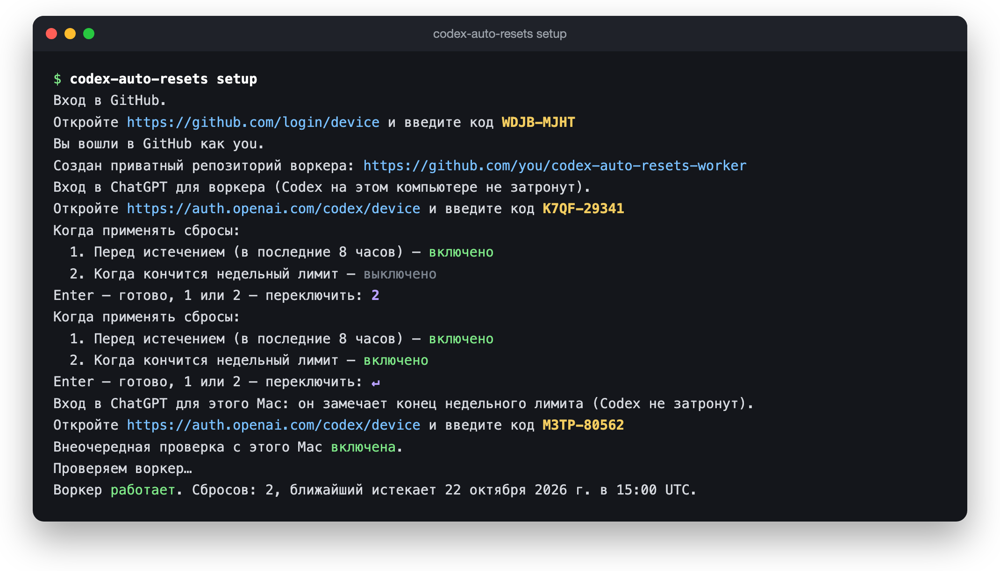
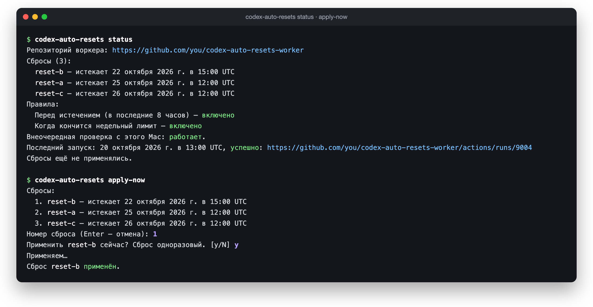

# Installation and use

**English** · [Русский](installation.md)

The CLI speaks Russian; the messages quoted below are given in Russian with a translation.

## What you need

- A Mac. The worker itself runs on GitHub; the Mac is for commands and, if you want it, for watching the weekly limit (see [The Mac check](#the-mac-check)).
- A GitHub account. The free plan is enough.
- A paid ChatGPT subscription that issues rate-limit resets.

## Install

From source, with Node 26:

```sh
git clone https://github.com/Keshaqaz/ares.git && cd ares
npm ci && npm run build:worker
echo "alias codex-auto-resets='node $PWD/src/cli/main.mjs'" >> ~/.zshrc && source ~/.zshrc
```

The last line sets up the `codex-auto-resets` command this guide uses. Without it, run `node src/cli/main.mjs` from the project folder.

Homebrew (`brew install keshaqaz/tap/codex-auto-resets`) arrives with the first release.

## First setup

```sh
codex-auto-resets setup
```



1. **GitHub sign-in.** Open the link, enter the code and allow access. The sign-in is kept in the Keychain, so you won't be asked again.
2. **Repository.** A private repository `codex-auto-resets-worker` appears in your account. The worker lives there.
3. **ChatGPT sign-in.** Open the link, enter the code and sign in to the account with the resets. This sign-in belongs to the worker alone: Codex on your computer keeps working as before.
4. **Rules.** Choose when resets are applied (see below). Enter keeps the defaults.
5. **ChatGPT sign-in for this Mac.** Only if the rule "When the weekly limit runs out" is on. Open the link and enter one more code, for the same ChatGPT account. The CLI installs a launchd agent that watches the weekly limit:

   ```
   Вход в ChatGPT для этого Mac: он замечает конец недельного лимита (Codex не затронут).
   Откройте https://auth.openai.com/codex/device и введите код ABCD-12345
   Внеочередная проверка с этого Mac включена.
   ```

   ("ChatGPT sign-in for this Mac: it notices when the weekly limit runs out (Codex is untouched). Open … and enter the code …. The out-of-schedule check from this Mac is on.")

6. **Check.** The CLI runs the worker once and shows the result:

   ```
   Воркер работает. Сбросов: 2, ближайший истекает 22 октября 2026 г. в 15:00 UTC.
   ```

   ("The worker is running. Resets: 2, the next one expires on 22 October 2026 at 15:00 UTC.")

If `setup` is interrupted, run it again: it picks up where it stopped and loses nothing.

## Rules

| Rule | Default | What it does |
| --- | --- | --- |
| Before expiry (last 8 hours) | on | Applies a reset when less than 8 hours are left before it expires. |
| When the weekly limit runs out | off | As soon as the worker sees the weekly limit is used up, applies the reset that expires first. While the Mac is awake, the Mac check notices the end of the limit, and the reset comes within minutes. |

The rules cover all resets at once and work independently. Change them any time with `codex-auto-resets rules`; new rules take effect from the next worker run. Turning the weekly rule on in `rules` asks for a ChatGPT code for this Mac, as in step 5 of setup. Turning it off removes the Mac check and revokes the Mac's ChatGPT sign-in.

The worker runs about once an hour, but GitHub sometimes delays runs by several hours, so the rules don't fire at an exact minute.

## The Mac check

While the rule "When the weekly limit runs out" is on, a launchd agent runs `codex-auto-resets watch` every 2 minutes. It is a short pass with no windows and no questions:

1. It reads the weekly limit with the Mac's own ChatGPT sign-in. This spends neither the limit nor tokens.
2. If the limit has run out, it starts the worker through GitHub, once per weekly window, with the same GitHub sign-in from the Keychain that the commands use.
3. It writes the outcome as one timestamped line to `~/Library/Logs/codex-auto-resets/watch.log`.

The Mac never applies a reset itself. The worker reads the limit again with its own sign-in and decides by the rules, so a mistake on the Mac never spends a reset. The end of the limit is seen whichever client used it up: Codex, opencode, your phone, another computer.

The check works only while the Mac is awake and you are logged in to your macOS account. The rest of the time, the worker's scheduled run notices the end of the limit.

The agent asks nothing and signs in nowhere. If the Mac's ChatGPT sign-in is lost, the pass is skipped, and `status` says what to do. If there is no GitHub sign-in, the pass is skipped too; any command asks you to sign in again.

Lines in `watch.log` (after the time of the pass):

| Line | Meaning |
| --- | --- |
| `idle` | The limit has not run out, or the worker was already started for this weekly window. |
| `dispatched` | The limit ran out; the worker was started. |
| `transient_error: …` | ChatGPT did not answer this time; the next pass retries. If `transient_error: wham_429` keeps repeating, ChatGPT is throttling the polling, and the reset will come later. |
| `reauth_required…` | The Mac's ChatGPT sign-in is lost. Run `codex-auto-resets setup`. |
| `no_session` | The Mac has no ChatGPT sign-in. If the weekly rule is on, run `codex-auto-resets setup`. |
| `no_github_token`, `github_error: unauthorized` | The GitHub sign-in is missing from the Keychain, has expired, or the Keychain is locked. Any command, such as `codex-auto-resets status`, asks you to sign in again. |
| `no_worker`, `foreign_repository`, `dispatch_refused`, `github_error: …` | There is no worker repository, it was not created by the CLI or is public, the workflow is disabled, or GitHub did not answer. `codex-auto-resets status` shows the details. |
| `error: …` | An unexpected error in the pass; the next pass starts over. |

A line ending in `(watch.json not saved)` means the pass could not write `watch.json`.

## Day to day

**Check that everything is fine:**

```sh
codex-auto-resets status
```



Shows the resets, the rules, the Mac check, the last run and the last application. If something is wrong, a line starting with «Внимание!» ("Warning!") at the bottom says what to do.

The line about the Mac check comes in three forms:

```
Внеочередная проверка с этого Mac: работает (последняя проверка 19 октября 2026 г. в 14:02 GMT+7).
Внеочередная проверка с этого Mac: выключена.
Внеочередная проверка с этого Mac: не работает.
```

("The out-of-schedule check from this Mac: working (last check …) / off / not working.") "Off" means the weekly rule is off (or the rules do not read, which `status` reports above), as it should be. "Not working" means the rule is on, but the agent is not running or the Mac's ChatGPT sign-in is lost; a «Внимание!» line below then says what to do.

**Apply a reset right now:**

```sh
codex-auto-resets apply-now
```

Pick a reset by its number and confirm with `y`. The CLI waits for the worker and reports the result; this can take a few minutes. A reset is single-use, and applying it cannot be undone.

## When something breaks

When a worker run fails, GitHub emails you. Run `codex-auto-resets status`: it shows the cause and the fix. Common cases:

| Message | What to do |
| --- | --- |
| Воркер потерял вход в ChatGPT (the worker lost its ChatGPT sign-in) | `codex-auto-resets login` and sign in again. Rules and history are kept. |
| Воркер выключен в GitHub (the worker is disabled in GitHub) | Open the link in the message and click **Enable workflow**. |
| Воркер не запускался уже N ч (the worker hasn't run for N hours) | Open the link in the message and check that GitHub Actions is working. Runs usually resume on their own. |
| Это другой аккаунт ChatGPT (this is a different ChatGPT account) | Sign in to the account the worker was set up for. Switching accounts takes a reinstall: `uninstall`, then `setup`. |
| Установка не завершена (setup is not finished) | `codex-auto-resets setup`. |
| Воркер устарел (the worker is out of date) | `codex-auto-resets upgrade`. |
| Вход этого Mac в ChatGPT потерян (this Mac's ChatGPT sign-in is lost) | `codex-auto-resets setup` and enter a ChatGPT code for this Mac again. |
| Внеочередная проверка с этого Mac не запущена (the check from this Mac is not running) | `codex-auto-resets setup`: it installs the agent again. |

If `setup`, `rules` or `upgrade` prints «Внеочередная проверка с этого Mac не запустилась (launchctl …)» ("the check from this Mac did not start"), launchd did not take the agent. The rest of the command is done; run `codex-auto-resets setup` again.

## Upgrade

From source, in the project folder:

```sh
git pull && npm ci && npm run build:worker
codex-auto-resets upgrade
```

With Homebrew:

```sh
brew upgrade codex-auto-resets
codex-auto-resets upgrade
```

`codex-auto-resets upgrade` updates the worker in your repository; without it, the old version keeps running there. Rules, history and the ChatGPT sign-in are kept. With the weekly rule on, `upgrade` also reloads the Mac check agent when its plist changed.

Installed from source, the agent runs the `node` and the `src/cli/main.mjs` you last ran `setup`, `rules` or `upgrade` with. If you move the folder or change Node, run `setup` again.

Installed with Homebrew, the agent runs the program through the link `$(brew --prefix)/opt/codex-auto-resets`, so after `brew upgrade` it runs the new version right away.

## Uninstall

```sh
codex-auto-resets uninstall
```

Then remove the program: the source folder and the `alias codex-auto-resets=…` line in `~/.zshrc`, or `brew uninstall codex-auto-resets` if you installed with Homebrew.

`uninstall` asks you to sign in to GitHub once more: deleting a repository needs a separate permission, which the CLI does not keep. It then revokes the worker's ChatGPT sign-in and deletes the repository. Next it removes the Mac check agent, revokes the Mac's ChatGPT sign-in and deletes its files and log, and finally removes the GitHub sign-in from the Keychain. Open the GitHub page it links and click **Revoke** to close access completely.

If the program is already gone and the agent is still there, it's best to install the program again and run `uninstall`: only it revokes the Mac's ChatGPT sign-in. To remove the agent and the files by hand, without revoking the sign-in:

```sh
launchctl bootout gui/$(id -u)/com.github.keshaqaz.codex-auto-resets.watch
rm ~/Library/LaunchAgents/com.github.keshaqaz.codex-auto-resets.watch.plist
rm -r ~/Library/Application\ Support/codex-auto-resets ~/Library/Logs/codex-auto-resets
```

## What is stored where

| Where | What |
| --- | --- |
| Keychain on your Mac | the GitHub sign-in (entry `codex-auto-resets`) |
| Repository `codex-auto-resets-worker` | the worker code, schedule, rules, an open summary (resets and their deadlines, no sign-in or account data) and the worker's encrypted ChatGPT sign-in |
| Secret `STATE_KEY` in the repository settings | the key that encrypts the worker's sign-in |
| `~/Library/LaunchAgents/com.github.keshaqaz.codex-auto-resets.watch.plist` | the Mac check agent, while the weekly rule is on |
| `~/Library/Application Support/codex-auto-resets/chatgpt-session.json` | this Mac's ChatGPT sign-in, while the weekly rule is on |
| `~/Library/Application Support/codex-auto-resets/watch.json` | the weekly window the worker was already started for, and the outcome of the last check |
| `~/Library/Logs/codex-auto-resets/watch.log` | one line per Mac check, 20–35 KB a day, not rotated |

The GitHub sign-in gives the CLI access to all your repositories, like `gh`. The worker repository must stay private: if you make it public, the CLI refuses to work with it.

The Mac's ChatGPT sign-in is kept in a `0600` file, not in the Keychain: it is longer than the CLI can safely pass to the Keychain (details in [ADR-0005](adr/0005-weekly-check-from-mac.md)). Any program running as your macOS user can read the file; that is the same level of access as the Codex sign-in. The sign-in is used only to read the limit, and turning the weekly rule off or `uninstall` revokes it.

## What it costs

Nothing. GitHub Actions bills each worker run as at least one minute, which adds up to ~750 minutes a month. The Mac check adds at most one run per weekly window. The GitHub Free plan includes 2,000 minutes a month for private repositories. If your other private repositories use Actions too, keep the total in mind.
