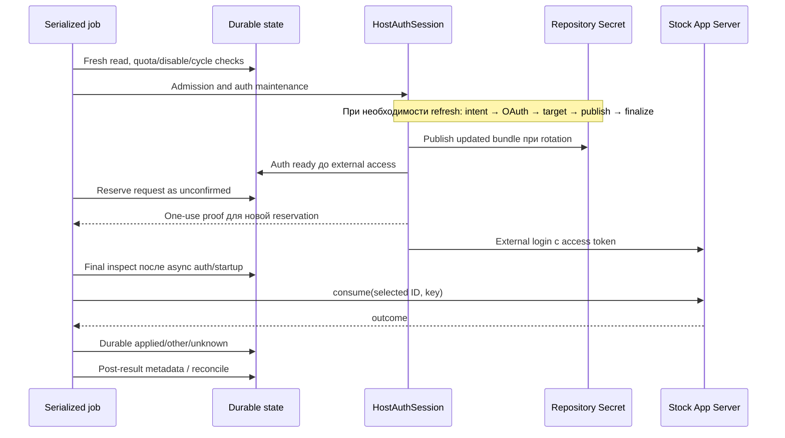

# Проверенный механизм применения выданного сброса

Зафиксирован 9 октября 2026 года после личного private пилота 21. Назначение
документа — сохранить воспроизводимый механизм и доказательства, чтобы дальнейшие
проверки реализации выполнялись на synthetic backend без расходования настоящих
выданных сбросов. Термины соответствуют [CONTEXT.md](../CONTEXT.md).

**Один настоящий выбранный сброс credit-A уже применён. Для повторного тестирования
не выполнять live select/enable/apply-now/retry/consume и не выбирать второй сброс.**
Дальнейший live consume требует отдельного явного выбора пользователя; разрешение
завершённого пилота не является разрешением расходовать ещё одно одноразовое право.

Это описание проверенного пути на закреплённых версиях, а не гарантия свойств
сервера или доставки GitHub Actions. Synthetic успех и живой успех различаются
ниже. Полная хронология, admission и оставшиеся условия — в
[таблице поддержки](../support.md).

## 1. Версии и состав работающего пути

| Компонент | Проверенная конфигурация |
| --- | --- |
| Node | 26.10.0, см. [runtime-lock.json](../../runtime-lock.json) |
| Официальный Codex App Server | 0.160.1; собственная сборка не использовалась |
| Живой runner | GitHub Actions ubuntu-24.04, Linux x64 |
| Program pin успешного consume | `dabce8c87dbece8149ce45776b3e4720d4495178` |
| Авторизация | Отдельная CI-сессия; host-owned refresh; App Server получает external access token |
| Хранилище сессии | Repository Secret `AUTO_RESET_AUTH_BUNDLE`, generation2 |
| GitHub grant | Отдельный repository-scoped PAT; credential в документ не включён |
| Authoritative state | GitHub storage, актуальное чтение под общим writer; checkout snapshot не является state |
| Модельные вызовы | Не нужны для account RPC; модель в пилоте не запускалась |

Изменение binary/Node/auth transport требует повторной synthetic contract проверки.
Новый pin сам по себе не требует повторного расходования настоящего сброса.
Bootstrap marker может содержать первоначальный program SHA: текущий runtime pin
проверяется по workflow и `installation.programCommit`, а не только по marker.

Код пути:

- [private-cli.mjs](../../src/workflow/private-cli.mjs): сборка job, pilot gate, Secret snapshot, общий writer.
- [private-job.mjs](../../src/workflow/private-job.mjs): свежий receipt, reconcile, engine, cleanup и Summary.
- [host-auth-session.mjs](../../src/session/host-auth-session.mjs): host OAuth/publication, external runtime, одноразовое proof.
- [host-account.mjs](../../src/account/host-account.mjs): связь durable reservation с host proof.
- [account.mjs](../../src/account/account.mjs): metadata, eligibility, consume RPC и интерпретация ответа.
- [reset-cycles.mjs](../../src/core/reset-cycles.mjs): цикл, intent, финальный guard, durable outcome.
- [github-storage.mjs](../../src/github/github-storage.mjs): CAS и проверка записанного state.
- [schedule-planner.mjs](../../src/schedule/schedule-planner.mjs): admission и публикация/очистка cron.

## 2. Account RPC без модели

App Server запускается со stdio транспортом. Runtime выполняет external login:

```json
{"type":"chatgptAuthTokens","accessToken":"<только access token>","chatgptAccountId":"<CI account>","chatgptPlanType":"<если известен>"}
```

Это параметры `account/login/start`, не команда для копирования в живой терминал.
Refresh token, PAT и полный auth bundle в дочерний процесс не передаются.
Host владеет отдельной CI-сессией по [ADR-0001](../adr/0001-host-owned-auth.md).

Metadata читается методом `account/rateLimits/read`:

```json
{"excludeResetCreditDetails":false,"supportsLunaReserve":false}
```

Для применения нужен конкретный `creditId`, который свежий список описывает как
`resetType=codexRateLimits`, `status=available`, с подтверждённым expiry. Известный
expiry должен быть строго позже текущего времени. `expiry.kind=none` допустим;
`unknown`, `redeeming`, `redeemed`, неподдержанный resetType и отсутствие выбранного
ID не разрешают отправку. Неполный список не разрешает автоматически подставить
другой ID. `availableCount` сам по себе не идентифицирует выданный сброс.

Реальный мутирующий RPC только один:

```text
account/rateLimitResetCredit/consume
params = { creditId: выбранный ID, idempotencyKey: ключ этой попытки }
```

Низкоуровневый вызов в обход engine/журнала/current-job proof не является
поддержанным способом живого применения. Передача правильного ID без durable
intent и финального guard недостаточна.

## 3. Условия допуска перед отправкой

Условия проверяются по актуальному состоянию установки, а не по прошлому зелёному run:

1. Общий serialized writer принадлежит текущей job; storage preflight прошёл.
2. Program pin согласован с установкой; pending admin operation отсутствует.
3. Live pilot gate совпадает с точным repository; сама переменная не заменяет
   разрешение пользователя на конкретный сброс.
4. Установка не disabled/revoked/reconnectRequested; unresolved consume отсутствует.
5. Auth ready, текущий Secret согласован с committed auth tuple; generation не откатывается.
6. Fresh quota receipt действительно получен из нового provider observation:
   возраст не более 300 секунд, дата не из будущего. Переставить observedAt у старого
   receipt нельзя. Общий период учитывает used, discovery, активные слоты,
   service/queued jobs, очистку старых cron, резерв100 и запрет платного расхода.
7. Scheduler active и quota admission действителен непосредственно перед consume.
8. Есть один due current cycle: `scheduledAt ≤ now`, `nextAttemptAt ≤ now`,
   `now < deadline`, выбранный ID и минутные группы не конфликтуют/не заблокированы.
9. Свежая metadata подтверждает eligibility именно выбранного ID.
10. Для явного select и недельного правила: включена weeklyAutoReset; свежий
    identity-bound ответ подтверждает недельное окно 10080 минут, исчерпание и
    будущий resetsAt. Проверка повторяется до reservation и перед send после
    startup/auth. С 14 октября 2026 (решение пользователя) правило «за 30 минут до
    истечения» требует только своей включённой галочки, а «применить сейчас»/retry
    обходят недельное условие; пункты 1–9 действуют для всех. Пилот 21 проверял
    редакцию до этого решения.

В пилоте новый явный select заменил истёкший цикл. Старый status `scheduled`
не означал живое окно. `attemptUntil` сократил deadline до30минут от выбора,
но сохранил настоящий expiry в `originalDeadline`. Refresh/resume/apply-now
не должны расширять сохранённый короткий предел. Автоматической замены на второй
сброс нет. [Модель состояния](reset-cycle-state.md) описывает обычные циклы и группы.

## 4. Порядок авторизации и durable reservation



Стрелка publication выполняется при rotation; обычная job с действующим access
token не обязана снова обновлять OAuth. Публикация/согласование auth завершаются
до account RPC. GitHub Secret нельзя скачать через REST: наблюдение следующей
job, загрузившей generation2 из Secret и успешно прочитавшей account, является
отдельным evidence меж-job публикации. Нельзя «проверять readback» чтением plaintext
Secret из API или возвращаться к старому local vault generation1.

До первой возможности отправить consume engine сохраняет:

```text
requestId, cycleId, creditId, groupKeys, idempotencyKey,
attemptAt, nextAttemptAt=attemptAt+300,
state=unconfirmed, reason=reserved_outcome_unconfirmed, finishedAt=null
```

Cycle и группа также становятся unconfirmed. Эта запись должна быть подтверждена
storage до RPC. Host proof выдаётся только для новой reservation этой job и
связывается с exact request/version; старый журнал или известный ключ не дают
права повторить отправку. Proof расходуется при вызове host consume.

После всех async auth/startup действий финальный `inspect` снова проверяет exact
version, request tuple, current cycle, disable/revoke, quota, deadline и группы.
Допускаются только ожидаемая reservation version либо три собственные подтверждённые
auth versions; произвольный сдвиг версии запрещён. Guard и начало RPC выполняются
в одном финальном callback; сетевой ответ ожидается после выхода из критической секции.
Ручной pause после send не отменяет уже отправленный запрос.

## 5. Ответ сервера и фиксация результата

AccountAdapter принимает объект ровно с одним строковым полем `outcome`:

| Ответ | Durable state | Поведение |
| --- | --- | --- |
| `reset` | `applied` | Успех выбранной попытки; дальнейшие consume для этой группы блокируются |
| `nothingToReset` | `nothingToReset` | Подтверждённое отсутствие применения; цикл может ждать следующую допустимую попытку |
| `noCredit` | `noCredit` | Не доказательство успеха; reconcile выбранного ID, без подстановки второго |
| `alreadyRedeemed` | `unconfirmed` | Selected-ID/key identity сервером не доказана; остановка |
| Неожиданный ответ, transport loss, timeout | `unconfirmed` | Остановка; ни прежний, ни новый ключ не повторяется |
| Финальный guard доказал отсутствие send | `notSent` | Не расход сброса; причина сохраняется, последующий допуск отдельно |

Engine проверяет совпадение creditId/idempotencyKey в результате адаптера с intent.
Эти поля адаптер связывает с исходным запросом; они не являются server echo и
не доказывают server idempotency scope/TTL/binding. Поле `requests[].result.outcome`
в живом state отсутствует: доказательство — `requests[].state=applied`, matched
выбранный ID, `current cycle.status/lastResult=applied` и источник mapping в адаптере.

Успех записывается **до** best-effort чтения metadata и cleanup. Post-read failure
не меняет уже подтверждённый reset на новый consume. Если RPC мог уйти, но запись
результата потеряна, durable intent остаётся unknown и повтор запрещён. Нельзя
очистить историю, создать новый state или reconnect, чтобы обойти этот запрет.

Для GitHub write после одного PUT выполняются ограниченные повторные **чтения**
через100/300/1000ms только при временно меньшей version. Требуется exact hash.
Equal-version hash mismatch/newer version остаются ошибками; PUT/consume не
повторяются. Это исправление проверено regression и затем настоящим пилотом.

## 6. Доказательства единственного настоящего применения

Все даты — 9 октября 2026. Bangkok=UTC+7. Персональные ID/ключи/tokens не сохраняются.

| Этап | Run / durable evidence |
| --- | --- |
| Исходный read-only snapshot | v62 disabledtrue, generation2, requests[], cron[], pendingjobs0 |
| Disabled account check | 37873502314, v66; credit-A available, earliest, два сброса; сравнение ID приватное |
| Explicit bounded select | 37873597464, v71; start02:17:10UTC, deadline02:44:10UTC; старый цикл superseded |
| Enable | 37873743526, v76; свежий manual receipt, bounded cron readback |
| Применение | run `37873863210`, success; durablev83 |
| Точная попытка | attempt02:18:00UTC /09:18:00Bangkok; finished02:18:05UTC /09:18:05Bangkok; задержка отstart50s |
| Подтверждённый результат | Ровно1request applied/reasonnull; ID совпал с credit-A; current cycle applied/lastResultapplied |
| Очистка | run `37873960785`, success; v87 disabledtrue/cron[]/pendingnull |
| Независимая следующая job | 37874115470, v91; disabled, generation2, details metadata availableCount1; credit-A отсутствует, второй available |
| Окончательный snapshot | 02:22:19UTC: v91, publicationconfirmed, cron[], operationdone, pendingjobs0, requests1applied |
| Расход | 26completedruns=32roundedminutes, новый этап6jobs=6minutes; UI31/2000/$0billable отставал на последнюю checkjob |

Исчезновение credit-A и уменьшение availableCount подтверждают наблюдение после
reset, но сами по себе не заменили бы durable outcome. Статус `redeemed` отсутствующей
строке не приписывается. Installation metadata до финального check была старым
snapshot, поэтому её прежний availableCount2 не означал неприменение.

Живой успех относится к одному consume и отдельной CI-сессии на указанных версиях.
Первый активный cron был02:22UTC, расписание уже снято до него: применение подтверждено
manual dispatch, своевременная cron delivery этим опытом не доказана.

## 7. Дальнейшие тесты без настоящих сбросов

### Уровень A: offline regression

Mock RPC, synthetic GitHub/Actions/Secret/OAuth, управляемые часы и временные
файлы проверяют state/auth/planner/installer без реальных account credentials.
Основные команды из корня проекта на закреплённом Node:

```sh
node --version
node --test test/*.test.mjs
```

Версия должна быть `v26.10.0`. Для точечных изменений можно запускать относящиеся
к ним файлы; весь suite повторять при общих изменениях. Последнее сохранённое
полное evidence до пилота:236passed,14expected stock skips. Это исторический
результат проверки исходников, не новый прогон при написании документа.

### Уровень B: stock binary + synthetic HTTP

Настоящий официальный App Server вызывается существующим contract runner,
но account/OAuth ответы возвращает **локальный fake backend**. Это не живой consume.

macOS:

```sh
AUTO_RESET_CODEX_BIN=/absolute/path/to/pinned/codex node test/support/contract.mjs
```

Linux x64, после установки pinned runtime и OS prerequisites:

```sh
AUTO_RESET_CODEX_BIN="$PWD/.runtime/codex" scripts/test-contract-linux.sh
```

`test/support/contract.mjs` включает четыре contract suites и выставляет
`AUTO_RESET_CONTRACT_MODE=app-server`. Ручной запуск одного stock test файла
без этой переменной может дать skips и не считается его проверкой.
Последний сохранённый pinned stock результат:25passed,0skipped.

[bench.mjs](../../test/support/bench.mjs) и host/workflow fixtures обеспечивают:

- Отдельные временные HOME/CODEX_HOME; synthetic JWT/account/refresh tokens,
  отсутствие импорта desktop auth и настоящей CI-сессии.
- Synthetic account/OAuth endpoints на loopback; запрещённый model endpoint,
  audit account-only RPC и проверку отсутствия неожиданных внешних обращений.
- macOS OS guard ограничивает сеть портом fixture и чтение desktop auth;
  Linux wrapper создаёт namespace только с loopback, тесты идут non-root.
- Pins и configWarning guards сохраняются. Запрет loopback bind внешним sandbox
  означает ограничение стенда, а не повод заменить fake endpoint на настоящий.

До запуска выбрать pinned binary; не снимать network guard и не прокидывать
реальный PAT/auth bundle в synthetic fixture. Synthetic fixtures должны сохранять
собственную изоляцию, даже когда shell разрешена сеть для установки зависимостей.
Использовать имеющийся runner, а не ad-hoc production RPC для «быстрой проверки».

### Матрица регрессии и точки входа

| Проверка | Существующее evidence / файлы |
| --- | --- |
| Exact selected ID, outcome parsing, local key reuse, noCredit, invalid/partial metadata | [contract.test.mjs](../../test/contract.test.mjs), [fake-backend.mjs](../../test/support/fake-backend.mjs) |
| Cadence, expiry, deadline, attemptUntil, disable, group lock, unknown through restart | [reset-cycles.test.mjs](../../test/reset-cycles.test.mjs), cycle crash fixture |
| Host publication до external login, current-job proof, grant mismatch, recovery | [host-auth.test.mjs](../../test/host-auth.test.mjs), [host-auth-runtime-contract.test.mjs](../../test/host-auth-runtime-contract.test.mjs) |
| End-to-end writer/reservation/consume, final guard после startup, cleanup | [private-workflow.test.mjs](../../test/private-workflow.test.mjs) |
| Stock success/nothingToReset/401/lost-response/post-success401; отсутствие replay | [private-workflow-runtime-contract.test.mjs](../../test/private-workflow-runtime-contract.test.mjs) |
| PUT/readback, временно старое чтение, exact hash/version conflict | [github-storage.test.mjs](../../test/github-storage.test.mjs) |
| Freshness/quota pause, active cron removal, total period admission | [schedule-planner.test.mjs](../../test/schedule-planner.test.mjs), private workflow tests |
| Encrypted command receipts, HTTP200/204, upgrade/pause/enable gates | [installer.test.mjs](../../test/installer.test.mjs) |

Потерю ответа, crash послеSend, повтор ключа, malformed responses, 401 и сбои
persistence воспроизводить только на fixtures. Для changed boundary добавить
synthetic regression, получить ожидаемую failure до fix и pass после fix.
Успешный mock/fake replay не переносится на свойства настоящего сервера.

Оценка 9 октября после пилота: добавлен отдельный stock success-response-401
(backend уже применил сброс, сам consume ответил401), сохраняющий unconfirmed
и exact history после следующей job за deadline. Поведенческих дефектов не найдено;
265 offline passed/15 expected stock skips,26 stock passed/0skips на прежних pins.
[Границы клиентской и серверной проверки](../support.md).

### Уровень C: проверки существующей живой установки

Для диагностики использовать read-only durable status/run history/cron readback.
Account read при необходимости — только штатный disabled check с актуальной
Repository Secret и отдельным честным quota admission служебной job. Force refresh
вращает OAuth credentials и не нужен для проверки consume parsing/state.
Blank workflow_dispatch при enabled установке может вызвать consume, поэтому
не использовать его как нейтральный smoke test. Повторный `enable` со свежим receipt
также не является безопасным synthetic тестом. Старые helper select/enable команды
из архивной передачи пилота не являются текущим планом тестирования.

Сохранять applied/unknown историю. PAT не отзывать/не перевыпускать; local vault
generation1 устарел, reseed/refresh из него запрещён. Второй available сброс
не использовать для проверок. Текущая disabled установка сохраняется.

## 8. Границы доказательств

Подтверждены живые external account read, host OAuth generation1→2/publication,
один selected-ID reset, результат между jobs и снятие cron. Offline/stock suites
покрывают клиентские границы и failure paths, не реальную серверную идемпотентность.

Не подтверждены: server key scope/TTL/binding/replay, естественный allowance-zero
runner, revoke propagation (credentials сохраняются по выбору пользователя),
длительная active schedule delivery/SLA. Позже в пилоте 21 подтверждены unattended quota provider,
доставка окна внешним таймером и revoke; границы — в [таблице поддержки](../support.md).
Их нельзя «доказать» повторным расходованием второго сброса или одним зелёным job.
При unknown consume остаётся поддержанным только остановка без replay.
Тикет 21 закрыт 14 октября 2026;
этот документ фиксирует уже доказанный механизм, а не расширяет live допуск.

## 9. Что сохранить при будущих изменениях

Обновлять этот документ при изменении RPC shape, auth lifecycle, durable protocol,
final guard, outcome mapping или поддерживаемых pins. В записи проверки указывать
commit/версии, suite, число passed/skipped, проверяемую границу и вид backend.
Для повторяемой регрессии достаточно synthetic ID/ключа/ответа; настоящий creditId,
PAT, tokens, auth bundle/ciphertext и raw account/state в документ не включать.
Новый живой результат отделять от synthetic evidence и получать новое явное
разрешение на одноразовое право. Отсутствие такого результата не мешает проверять
изменения на сохранённом synthetic стенде.
